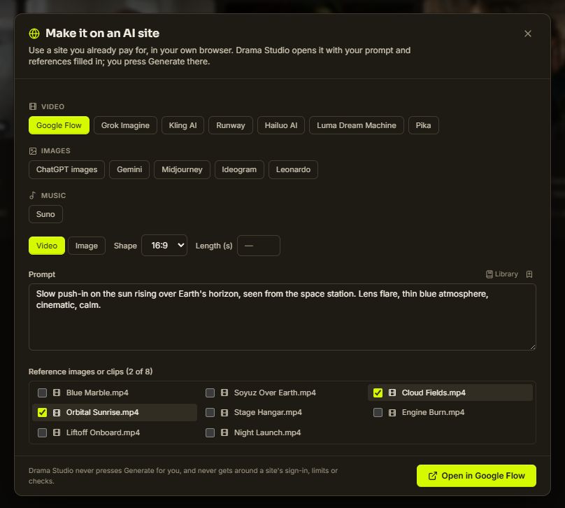

<div align="center">


# Drama Studio™

**An AI video workstation: a real timeline editor for you, a built-in AI assistant, and 100+ MCP tools for your agents.**


[](LICENSE)

[](https://discord.gg/5nAZVQ7K4)
[](http://jepoy.dev/)
[](https://jepoy.dev/sponsor#support-form)

English · [Español](docs/i18n/README.es.md) · [简体中文](docs/i18n/README.zh-CN.md) · [日本語](docs/i18n/README.ja.md) · [한국어](docs/i18n/README.ko.md) · [Português (Brasil)](docs/i18n/README.pt-BR.md) · [Français](docs/i18n/README.fr.md)

</div>

<p align="center"></p>
<p align="center"><i>One request. The agent lays out the shots, adds music, titles, a grade and dissolves — live, through Drama Studio's MCP tools, and every step can be undone.</i></p>

Drama Studio is a free, open-source (GPL-3.0) desktop video editor and AI video workstation for Windows, macOS and Linux. It brings story planning, generation, asset management, timeline editing, captions, sound, effects, and export into one project-based app.

Editing, captions, subtitles, sound effects, export, project management, the AI Assistant and MCP editorial tools work without ComfyUI. On-device image, video and voice generation runs through a locally running ComfyUI. Without ComfyUI you can still make media on AI sites you already use through **Drama Studio Companion**, and use cloud text to speech with your own ElevenLabs key.

Use built-in local and cloud workflows, bring your own ComfyUI API workflow JSON, or install the bundled Drama Studio Bridge so a graph open in ComfyUI can be sent back into Drama Studio.

<p align="center">
  
</p>

## What Drama Studio Is For

- Creating music videos from lyrics, timing, characters, keyframes, video shots, and timeline edits.
- Building UGC-style creator ads and small-business ads with editable shot plans.
- Running curated local and cloud image/video workflows from one Generate workspace.
- Running custom ComfyUI image, video, keyframe, and music-video workflows inside the app.
- Editing generated clips with tracks, transitions, effects, captions, proxy/cache tools, and export.
- Keeping generated media, prompts, workflow outputs, and timelines organized inside a project.

For generation, Drama Studio is not a replacement for ComfyUI. It is the production layer around ComfyUI: plan the work, send jobs to ComfyUI, collect the outputs, and finish the edit.

<p align="center">
  
</p>

## Download

Packaged builds are published on the [Drama Studio releases page](https://github.com/jeffreycayao/Drama-Studio/releases). If there is no build for your platform yet, [build it from source](#build-from-source).

Release assets include:

- `Windows Installer`
- `Windows Portable`
- `Linux AppImage`
- `Linux deb`
- `Mac (Apple Silicon)` and `Mac (Intel)` (unsigned for now)

Once installed, Drama Studio keeps itself up to date: the Windows installer and the AppImage download new versions in the background and install them when you restart, and the other builds tell you when a new version is out. Choose how in **Settings › Updates**.

**Opening the Mac app the first time:** the Mac builds are not signed with an Apple Developer ID yet, so macOS blocks the first launch. Drag Drama Studio to Applications, open it once, then go to **System Settings › Privacy & Security** and click **Open Anyway**. Smooth motion (RIFE frame interpolation) is not available in the unsigned Mac builds yet; everything else works. The Mac app tells you about new versions instead of updating itself.

GitHub's auto-generated source-code archives are only useful if you plan to [build Drama Studio from source](#build-from-source).

## Main Features

### Generate

Generate runs built-in local workflows, cloud/partner workflows, and custom ComfyUI workflows.

- Local image, video, image-edit, audio, and utility workflows.
- Cloud workflows such as Nano Banana 2, GPT Image 2, Seedance, Kling, and other partner-node routes where available.
- Custom Image and Custom Video workflows for users who want Drama Studio to run their own ComfyUI API graphs.
- API JSON import for advanced users who prefer exporting workflows manually from ComfyUI.
- Drama Studio Bridge support so compatible graphs can be sent from ComfyUI back to the correct Drama Studio panel.
- Workflow setup checks for missing nodes, models, credentials, and configuration.
- A Featured / My Workflows / Templates browser with Local and Cloud filters. Imported community workflows appear in Featured next to the built-ins.

<p align="center">
  
</p>

The Templates tab browses the official ComfyUI template catalog (650+ templates with size and popularity info) and launches any of them into the embedded ComfyUI editor (the **Advanced** tab).

<p align="center">
  
</p>

### Create

Create contains guided creator workflows built on Drama Studio's Director Mode engine.

- **Music Video Creation** - turns a song, lyric timing, characters, references, and a director script into keyframes, video shots, and an editable timeline.
- **UGC Creator** - builds creator-style social ads with hooks, dialogue, product demos, try-ons, testimonials, and editable shot-by-shot outputs.
- **Business Ad Creator** - builds offer-first ads for local businesses, ecommerce products, events, services, and small teams.
- **Short Film Creation** - experimental script-to-scene coverage workflow. This is still very beta and may have rough edges.

### Idea Pad and Motion Studio

- **Idea Pad** is for pre-production. Its **Story Board** has a column for each part of the story (acts, episodes or your own sections) and a row for each plotline, with beats and scenes in the cells. A **Relationship map** links characters, and starter templates (**Three-act short**, **Micro-drama episode**) give you a filled-in board to start from. An AI collaborator suggests twists and expands beats. Export a Fountain screenplay, or send the story to Short Film.
- **Short Film** imports Fountain (`.fountain`), Final Draft (`.fdx`) and plain-text scripts.
- **Motion Studio** lets AI edit a whole video. Pick a recipe (Talking head, Documentary montage, Music video, Social short), choose your clips, voice and music, approve the AI's scene plan, and it builds an editable timeline.

### Music Video Creation

The Music Video Creator supports:

- Song import and lyric timing.
- ASR transcription or pasted-lyrics alignment into SRT.
- People/cast setup, including existing character sheets.
- Per-shot keyframe prompts, reference images, prompt copy, prompt editing, image replacement, and shot reruns.
- Built-in keyframe routes such as Qwen Image Edit and Nano Banana 2.
- Custom keyframe workflows using Drama Studio endpoint nodes.
- Built-in video routes such as LTX 2.3 Music and WAN 2.2.
- Custom video workflows with optional injected keyframe image, prompt, seed, width, height, FPS, duration, and audio.
- Timeline assembly from generated shot assets.

### Timeline Editor

The editor includes:

- Project asset browser.
- Multi-track video/audio timeline.
- Clip trimming, moving, snapping, overlap replacement behavior, and transitions.
- Text, shape, title, solid-color, adjustment-layer, keyframe, and visual effect tools.
- Inspector controls.
- Layered tracks with a magnetic main track, ripple, roll, slip and slide edits.
- 15+ transitions and one-click color filters.
- Proxy/cache tools for smoother playback.
- Export panel for final renders.

### Sound

- **Sound effects library:** search a sound catalog, preview instantly and drag a sound onto an audio track. Connect a catalog in `Settings › Sound effects library`, or download a whole pack for offline use.
- **Auto-duck** music under dialogue, volume envelopes and EQ.
- **AI songwriter** and several music engines (through ComfyUI), plus Suno through Drama Studio Companion.

### Captions

Captions can be generated from edited timeline audio and styled in-app.

- **Subtitle files:** save captions as SRT or WebVTT for YouTube, Vimeo and web players, next to your export or on their own.
- **Translate captions** into 20+ languages with the same timing and style; one captions clip can hold several languages.
- Timeline-aware transcription.
- Caption style presets.
- Font, color, outline, background, shadow, and animation controls.
- Saved caption style presets for reuse.
- Live preview with play/scrub controls and safe-zone overlays.
- Export-ready caption renders.

### Export

The Export tab includes practical render presets, hardware-accelerated options where available, numbered PNG image sequence export, queue controls, and project-aware output settings.

<p align="center">
  
</p>

### AI Sites

**Generate › AI Sites** makes shots on AI sites you already use, in your own browser: video sites such as Google Flow, Grok Imagine, Kling AI and Runway, image sites such as ChatGPT and Midjourney, and Suno for music. Pick a site, write the prompt (or a song's style, lyrics and title) and tick reference pictures or clips from your project. The free **Drama Studio Companion** browser extension opens the site with everything filled in, and you press Generate there. Right-click a result in the browser and choose **Send to Drama Studio** to bring it into your project. Drama Studio never presses Generate for you and never gets around a site's sign-in, limits or checks.

<p align="center">
  
</p>

### Stock

The Stock tab searches free stock libraries and imports photos or videos straight into the current project: **Pexels**, **Unsplash** and **Pixabay** (free API keys, added in `Settings > Stock media`), and **Openverse**, **Wikimedia Commons** and **NASA** (no key needed). The author and license of every imported item are saved on the asset.

<p align="center">
  
</p>

### ComfyUI Integration

Drama Studio talks to a local ComfyUI server and can also help launch it.

- Default endpoint: `http://127.0.0.1:8188`
- Custom port support in Settings.
- Windows launcher support for a configured ComfyUI start script.
- macOS launcher support for a configured `ComfyUI.app`.
- Optional auto-start, stop-on-quit, and restart behavior.
- Embedded ComfyUI node editor (the **Advanced** tab) for opening and editing graphs.
- ComfyUI account login support inside the Advanced tab.
- ComfyUI credit balance display when available.

Only localhost/loopback ComfyUI endpoints are supported in the desktop app.

### Voices

- **Text to Speech (Qwen3 TTS):** free local voices, or a voice cloned from a short clip, in 10 languages.
- **ElevenLabs Text to Speech** (cloud) for Short Film voices on PCs without a strong graphics card.

### Help and finding features

- **Help Center (F1):** plain-language guides with diagrams, searchable in everyday words, plus **What's new**.
- **Report a bug:** the bug icon next to Help opens a short form and then a filled-in GitHub issue you submit, with your version and system info if you want.
- **Automatic updates:** new versions arrive on their own and install when you restart. **Settings › Updates** shows your version and lets you check now or choose when to download.
- **Search every action (Ctrl+Shift+P):** find any feature, including ones in right-click menus.
- **Quick actions:** select a clip and the actions that fit it appear at the top of the Inspector: AI tools (continue a shot, lip-sync, Smart Replace, translate captions, detect beats), editing tools (mask, compound clip, paste attributes, match frame, move by offset) and label colours.
- **AI tools button:** the selected clip on the timeline has an **AI tools** button with the same AI actions.
- **Prompt library:** ready-made prompts, prompts from packs you import, and your own, with {blanks} you fill in each time. Open it from **Prompts** in the top bar, Ctrl+Shift+P, or **Library** above a prompt box.
- **Video tutorials:** Help › **Watch**.
- **Idea Pad templates:** start a story from **Three-act short** or **Micro-drama episode** instead of an empty board.
- **Start without ComfyUI:** no strong graphics card? Edit, caption, translate and export right away; AI features offer to set ComfyUI up when you open them.

### AI Assistant

Click **Assistant** in the title bar to dock a chat panel beside the editor and ask for edits in plain language, for example "Tighten all pauses between dialogue on Track 1". Pick the model from the Assistant header or in `Settings > Agents (MCP) > Assistant AI`:

- **Local (free, private):** Ollama or LM Studio on this PC.
- **Your subscription (no API key):** Claude through Claude Code (Pro or Max), or Codex with your ChatGPT plan, when that app is installed and signed in on this PC.
- **Cloud (any PC):** Claude, OpenAI or DeepSeek with your own API key. Keys stay on this computer and are only sent to the provider you chose.

Switch between them from the model name under the Assistant's title.

Every change is shown as a preview first and only happens when you click **Apply**. Applied edits can be undone. Ask it how to use a feature and it answers from the Help Center.

### AI Agents (MCP)

Drama Studio includes a local MCP server with 100+ tools for Codex, Claude Code, Cursor-compatible tools, and other MCP clients.

- Endpoint: `http://127.0.0.1:19790/mcp`
- External connections are off by default. Enable authenticated loopback access using [the MCP setup guide](docs/MCP.md#quick-start); check status in `Settings > Agents (MCP)`. The built-in Assistant needs no HTTP listener.
- Guide: [docs/MCP.md](docs/MCP.md)

Agents can inspect the open project, review timeline frames and visible shots, troubleshoot ComfyUI setup, preview safe timeline edits, queue approved generation work, and start delivery exports.

Agents can also bring in community ComfyUI workflows: hand one a workflow link or file, and it analyzes the graph, reports missing custom nodes and models, installs them after your approval, and runs the workflow on your timeline assets.

Most MCP write tools support a preview step, and many default to preview-first behavior. Normal timeline edits participate in Drama Studio's undo system. Imports, exports, generated files, project creation, and other filesystem changes are not universally undoable, so agents should get explicit approval before applying them. MCP is the recommended automation path for agent-assisted review, timeline operations, graphics polish, and generation workflows.

<p align="center">
  
</p>

### Drama Studio Companion (browser extension)

Use the AI sites you already pay for, from inside Drama Studio. Install [Drama Studio Companion from the Chrome Web Store](https://chromewebstore.google.com/detail/inkjhigflcgkaganbiepogcpcfgndfog) in Chrome or Edge, then press **Connect** in its side panel and **Allow** in Drama Studio.

- Generate › AI Sites opens a site with your prompt, song lyrics and reference pictures filled in; you press Generate there.
- Right-click a result and choose **Send to Drama Studio** to put it in your project with its prompt.
- If no browser is connected yet, Drama Studio shows an **Add to Chrome** step and carries on once it connects.

The Companion always has the same version number as Drama Studio. Its source is in [`extensions/companion`](extensions/companion); see [Build from source](#build-from-source) to load a development build.

## Custom Workflows

Custom workflows are one of the main reasons Drama Studio exists.

**Import a pack someone shared:** the package button in the Assets panel, Generate › My Workflows › **Import pack…**, or drop the .zip on the app. It shows everything in the pack before anything is kept. Workflows go to My Workflows, images, audio and video to Assets, and LUTs to your LUT library. Code in a pack, such as browser extensions or scripts, is never run or installed.

Advanced users can:

1. Open a starter graph from Drama Studio.
2. Modify it in ComfyUI.
3. Keep the required Drama Studio endpoint nodes.
4. Send it back with the Drama Studio Bridge or import the API workflow JSON manually.
5. Run that graph from Drama Studio as part of a creator flow or from Generate.

Common Drama Studio endpoint node titles include:

- Drama Studio input image - `DRAMA_STUDIO_INPUT_IMAGE`
- Drama Studio prompt - `DRAMA_STUDIO_PROMPT`
- Drama Studio seed - `DRAMA_STUDIO_SEED`
- Drama Studio width - `DRAMA_STUDIO_WIDTH`
- Drama Studio height - `DRAMA_STUDIO_HEIGHT`
- Drama Studio FPS - `DRAMA_STUDIO_FPS`
- Drama Studio duration - `DRAMA_STUDIO_DURATION`
- Drama Studio audio - `DRAMA_STUDIO_AUDIO`
- Drama Studio output image - `DRAMA_STUDIO_OUTPUT_IMAGE`
- Drama Studio output video - `DRAMA_STUDIO_OUTPUT_VIDEO`

Exact `DRAMA_STUDIO_*` titles are preferred, but Drama Studio also recognizes readable titles such as `Drama Studio input image`. Older graphs that still use `COMFYSTUDIO_*` marker titles are supported for backward compatibility.

If an endpoint is present, Drama Studio can inject that value. If an endpoint is not present, the graph controls that setting itself.

<p align="center">
  
</p>

## Requirements

Normal editing:

- No ComfyUI installation or Comfy account is required.
- Allow enough disk space for project assets, cache files, and exports.

Generation:

- A separately installed local ComfyUI running on the same machine is required for the built-in and custom generation workflows (Generate, Create, Motion Studio shots, local voices).
- Local workflows may require compatible hardware, models, and custom nodes.
- Partner-node workflows require the appropriate Comfy.org credentials and credits.

Optional integrations:

- Pexels, Unsplash or Pixabay API keys for those Stock sources.
- Ollama or LM Studio for a local AI assistant; Claude Code or Codex signed in with your subscription; or a Claude, OpenAI or DeepSeek API key.
- An ElevenLabs API key for cloud text to speech.
- Chrome or Edge with Drama Studio Companion for AI Sites.

Local workflow requirements vary by model. Some workflows can run on modest GPUs, while heavy video workflows may need 24 GB+ VRAM. Cloud workflows shift most of that requirement to the provider but may require credits.

## First Run

1. Install and launch Drama Studio.
2. Choose a projects folder.
3. Create or open a project.
4. Use `Drama Studio > Getting Started` from the bottom menu if you want the guided setup path.

To use generation, configure your local ComfyUI instance in `Settings > ComfyUI Connection`. This step is optional for editing, captions, export, project management, and MCP editorial tools. If ComfyUI is running on a non-default port, update the endpoint in Settings and run the connection test.

## ComfyUI Setup Notes

Drama Studio ships workflow JSON files, but workflows still need the correct ComfyUI environment.

Depending on the workflow, users may need:

- Custom nodes installed in ComfyUI.
- Model files in the expected folders.
- Cloud/partner credentials.
- Enough local VRAM for the selected model and resolution.

Drama Studio talks to local ComfyUI without any CORS setup.

Inside Generate, use the workflow setup and dependency tools when something is missing.

## Build From Source

### Requirements

- **Node.js 22 or newer** and npm for the desktop app (CI uses Node 22). The Companion needs **Node.js 24** and **npm 11** (see `extensions/companion/package.json`).
- **Git**.
- Windows 10/11, macOS or Linux. Packaging for a platform has to run on that platform (or in CI).
- Optional: a local [ComfyUI](https://github.com/comfyanonymous/ComfyUI) for generation, and Chrome or Edge for the Companion.

FFmpeg and FFprobe come from npm packages (`ffmpeg-static`, `@derhuerst/ffprobe-static`), so you do not install them yourself. The RIFE smooth-motion engine is built in CI (see [docs/RIFE_RUNTIME.md](docs/RIFE_RUNTIME.md)). Local builds without it work normally; only smooth-motion reports the engine as missing.

### Desktop app

```bash
git clone https://github.com/jeffreycayao/Drama-Studio.git
cd Drama-Studio
npm ci                 # or: npm install
npm run electron:dev   # Vite on 127.0.0.1:5173 + Electron
```

Build a local Windows test exe (unsigned portable build in `release/`, launched when done):

```bash
npm run exe:latest
```

Other builds:

```bash
npm run electron:build:win     # Windows installer + portable
npm run electron:build:mac     # macOS dmg (run on a Mac)
npm run electron:build:linux   # AppImage + deb
```

`npm run build`, and every command that runs it (`exe:latest`, `electron:build:*`), bumps the patch version first. For a build that should not change the version, for example in a pull request, set `DS_SKIP_VERSION_BUMP=1`. Official, signed releases are built by GitHub Actions (`.github/workflows/release.yml`).

### Drama Studio Companion (browser extension)

The Companion is its own npm project. Run its commands from its folder:

```bash
cd extensions/companion
npm ci
npm run dev     # development build with reload
npm run check   # format, types, lint, unit and tooling tests, source scan
npm run build   # production build into .output/chrome-mv3
```

To try a build, open `chrome://extensions` (or `edge://extensions`), turn on **Developer mode**, click **Load unpacked** and pick the `.output/chrome-mv3` folder. See [extensions/companion/README.md](extensions/companion/README.md) for details.

### Tests

The app's tests are focused Node test scripts, one per area. Run `npm run` to list them, and run the ones for the area you changed, for example:

```bash
npm run test:chat-panel
npm run test:timeline-hotfixes
npm run test:versioning
```

More setup notes are in [SETUP.md](SETUP.md).

## Project Structure

| Path | What is there |
| --- | --- |
| `src/` | React renderer: `components/` (UI), `stores/` (Zustand state), `services/` (ComfyUI, export, captions, agents), `utils/`, `config/`, `i18n/` |
| `electron/` | Electron main process: IPC, file access, FFmpeg jobs, the local MCP server (`mcpServer.js`), ComfyUI detection, Companion link |
| `extensions/companion/` | Drama Studio Companion browser extension (WXT, Vue 3, TypeScript, Manifest V3) |
| `public/` | Static assets, bundled workflow JSON (`public/workflows/`), UI strings (`public/lang/`), fonts |
| `scripts/` | Build, packaging, release gates, version bump (`bump-version.cjs`), checks |
| `tests/` | Node tests for main-process and cross-cutting code (renderer tests sit next to their source as `*.test.mjs`) |
| `build/` | Icons, installer and Store packaging resources |
| `docs/` | User and developer docs, including [MCP.md](docs/MCP.md), translations in `docs/i18n/` |
| `.github/` | CI workflows and the pull request template |

## Versioning

Drama Studio uses `major.minor.patch` versions. Every `npm run build` bumps the patch number automatically (skipped on CI or with `DS_SKIP_VERSION_BUMP=1`). Maintainers use `npm run version:minor` or `npm run version:major` for bigger releases; do not edit the version in `package.json` by hand. Notes listed under `## [Unreleased]` in [CHANGELOG.md](CHANGELOG.md) are moved under the new version when it is bumped. Drama Studio Companion (`extensions/companion`) always gets the same version, and `npm run check:versions` confirms they match.

## Roadmap

See [ROADMAP.md](ROADMAP.md).

<p align="center">
  <a href="ROADMAP.md">
    
  </a>
</p>

## Community

- Discord: [discord.gg/5nAZVQ7K4](https://discord.gg/5nAZVQ7K4)
- Website: [jepoy.dev](http://jepoy.dev/)
- Sponsor: [jepoy.dev/sponsor](https://jepoy.dev/sponsor#support-form)

## Contributing

Contributions are welcome. Please read [CONTRIBUTING.md](CONTRIBUTING.md) before you start. In short:

- Every change goes through a **pull request** and needs approval from a human maintainer before it is merged. Nobody pushes directly to `main`.
- If you used AI tools to write any of the code, say so in the pull request. AI-assisted code must pass a **security review** and a **logic/correctness review** before merge.
- Tests and builds for the areas you touched must pass.

Report security problems privately as described in [SECURITY.md](SECURITY.md), not in public issues.

## License

Drama Studio is free software, licensed under the **GNU General Public License v3.0 only** (`GPL-3.0-only`). The full text is in [LICENSE](LICENSE), and copyright and attribution notices are in [NOTICE](NOTICE).

Copyright (C) 2026 Jeffrey Cayao and Drama Studio contributors.

Drama Studio is a fork of Velorn (formerly ComfyStudio), Copyright (C) 2026 Velorn contributors, which is also licensed under GPL-3.0. Its copyright notices are retained as the license requires, and code that first appeared in its earlier MIT-licensed releases keeps its MIT notice in [NOTICE](NOTICE).

Third-party components (FFmpeg, Electron, fonts, npm packages, the RIFE runtime) keep their own licenses. Packaged builds include them in a `licenses/` folder.

"Drama Studio" and the Drama Studio logo are trademarks of Jeffrey Cayao; the GPL does not grant rights to use them for other products.
