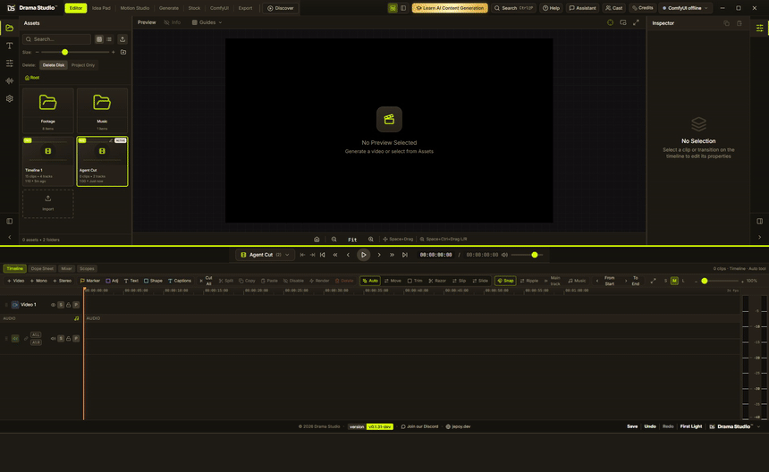
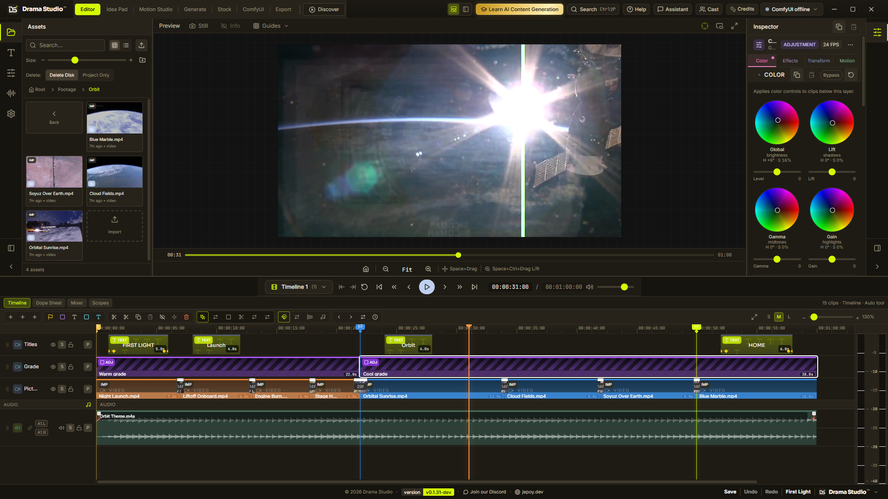
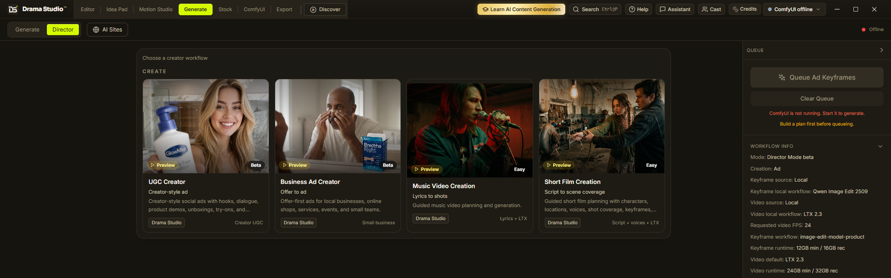
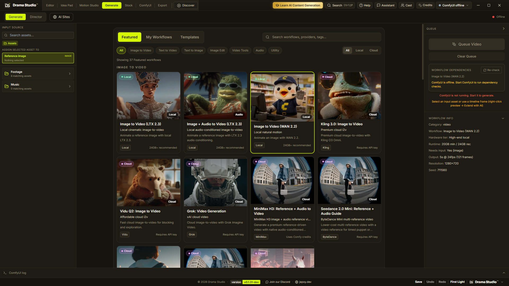
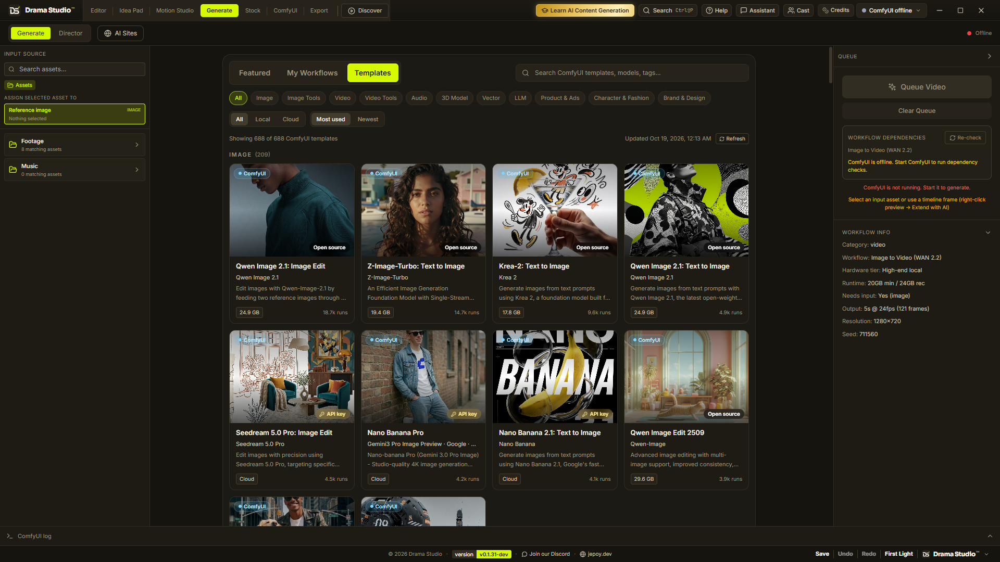
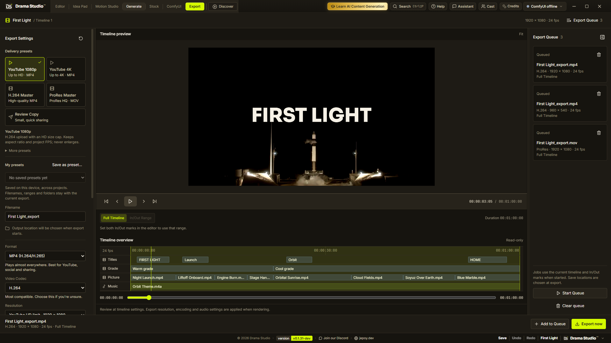
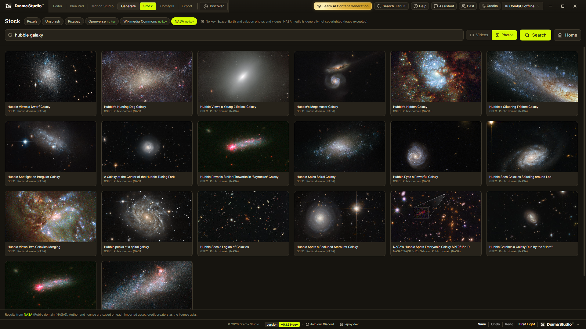
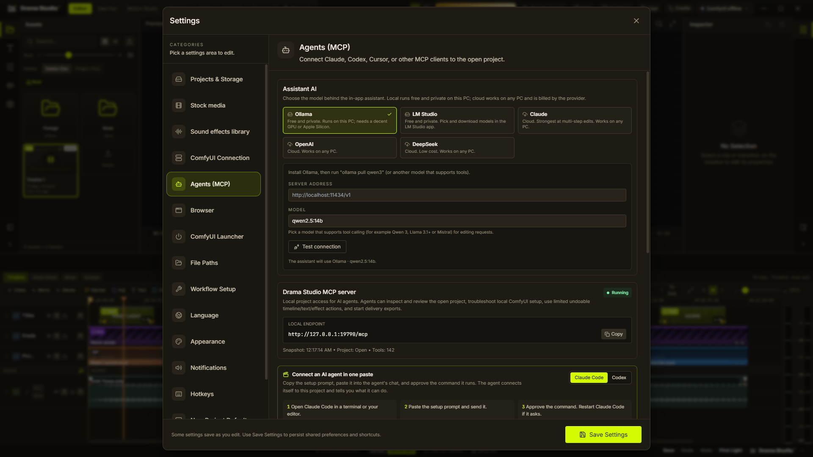
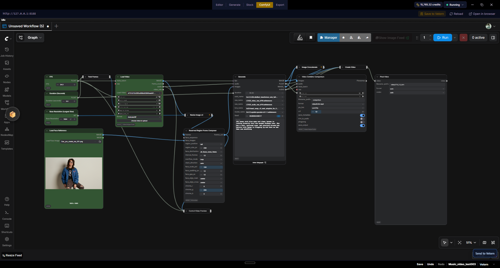

# Drama Studio

**La station de travail vidéo IA open source — un vrai éditeur pour vous, et plus de 100 outils MCP pour votre agent.**

[English](../../README.md) · [Español](README.es.md) · [简体中文](README.zh-CN.md) · [日本語](README.ja.md) · [한국어](README.ko.md) · [Português (Brasil)](README.pt-BR.md) · Français

<i>Un seul prompt. L'agent génère les médias, assemble la timeline et mixe l'audio — en direct, via MCP.</i>

> Cette traduction est maintenue au mieux. En cas de doute, le [README anglais](../../README.md) fait foi. Les PR d'amélioration sont les bienvenues !

Drama Studio est une station de travail vidéo IA open source pour ordinateur, pensée pour les créateurs qui utilisent ComfyUI. Elle réunit la planification, la génération, la gestion des assets, le montage sur timeline, les sous-titres, les effets et l'export dans une seule application organisée par projets.

Utilisez les workflows locaux et cloud intégrés, apportez votre propre JSON de workflow de l'API ComfyUI, ou installez le Drama Studio Bridge inclus pour qu'un graphe ouvert dans ComfyUI puisse être renvoyé vers Drama Studio.

  

## À quoi sert Drama Studio

- Créer des clips musicaux à partir de paroles, de synchronisation, de personnages, de keyframes, de plans vidéo et de montages sur timeline.
- Construire des publicités de type UGC pour créateurs et des publicités pour petites entreprises, avec des plans de tournage éditables.
- Exécuter des workflows image/vidéo sélectionnés, locaux et cloud, depuis un espace Generate unique.
- Exécuter des workflows ComfyUI personnalisés d'image, de vidéo, de keyframes et de clip musical dans l'application.
- Monter les clips générés avec pistes, transitions, effets, sous-titres, outils de proxy/cache et export.
- Garder les médias générés, les prompts, les sorties de workflows et les timelines organisés dans un projet.

Drama Studio ne remplace pas ComfyUI. C'est la couche de production autour de ComfyUI : planifier le travail, envoyer les tâches à ComfyUI, récupérer les sorties et finir le montage.

  

## Téléchargement

La plupart des utilisateurs devraient télécharger l'application de bureau packagée depuis la [page Releases de GitHub](https://github.com/jeffreycayao/Drama-Studio/releases).

Les fichiers de chaque release incluent :

- `Windows Installer`
- `Windows Portable`
- `Mac (Apple Silicon)`
- `Mac (Intel)`
- `Linux AppImage`
- `Linux deb`

Ignorez les archives de code source générées automatiquement par GitHub, sauf si vous comptez compiler Drama Studio depuis les sources.

## Fonctionnalités principales

### Generate

Generate exécute des workflows locaux intégrés, des workflows cloud/partenaires et des workflows ComfyUI personnalisés.

- Workflows locaux d'image, de vidéo, d'édition d'image, d'audio et utilitaires.
- Workflows cloud comme Nano Banana 2, GPT Image 2, Seedance, Kling et d'autres routes de nœuds partenaires lorsque disponibles.
- Workflows Custom Image et Custom Video pour ceux qui veulent que Drama Studio exécute leurs propres graphes de l'API ComfyUI.
- Import de JSON d'API pour les utilisateurs avancés qui préfèrent exporter leurs workflows manuellement depuis ComfyUI.
- Prise en charge du Drama Studio Bridge : les graphes compatibles peuvent être envoyés de ComfyUI vers le bon panneau de Drama Studio.
- Vérifications de configuration du workflow : nœuds, modèles, identifiants et réglages manquants.
- Un navigateur Featured / My Workflows / Templates avec filtres Local et Cloud. Les workflows communautaires importés apparaissent dans Featured à côté des workflows intégrés.

  

L'onglet Templates parcourt le catalogue officiel de modèles ComfyUI (plus de 500 modèles avec taille et popularité) et ouvre n'importe lequel dans l'onglet ComfyUI intégré.

  

### Create

Create contient des workflows créateurs guidés, construits sur le moteur Director Mode de Drama Studio.

- **Music Video Creation** - transforme une chanson, la synchronisation des paroles, des personnages, des références et un script de réalisation en keyframes, plans vidéo et une timeline éditable.
- **UGC Creator** - construit des publicités sociales façon créateur avec accroches, dialogues, démos produit, essayages, témoignages et sorties éditables plan par plan.
- **Business Ad Creator** - construit des publicités centrées sur l'offre pour commerces locaux, produits e-commerce, événements, services et petites équipes.
- **Short Film Creation** - workflow expérimental du scénario à la couverture de scènes. Encore très bêta, avec de possibles aspérités.

### Music Video Creation

Le créateur de clips musicaux prend en charge :

- L'import de chansons et la synchronisation des paroles.
- La transcription ASR ou l'alignement de paroles collées en SRT.
- La configuration des personnes/du casting, y compris les fiches de personnages existantes.
- Les prompts de keyframe par plan, images de référence, copie et édition de prompts, remplacement d'images et relance de plans.
- Des routes de keyframes intégrées comme Qwen Image Edit et Nano Banana 2.
- Des workflows de keyframes personnalisés utilisant les nœuds d'endpoint Drama Studio.
- Des routes vidéo intégrées comme LTX 2.3 Music et WAN 2.2.
- Des workflows vidéo personnalisés avec injection optionnelle d'image de keyframe, prompt, seed, largeur, hauteur, FPS, durée et audio.
- L'assemblage de la timeline à partir des assets de plans générés.

### Éditeur de timeline

L'éditeur comprend :

- Un navigateur d'assets du projet.
- Une timeline multipiste vidéo/audio.
- Le rognage et déplacement de clips, le magnétisme, le comportement de remplacement par chevauchement et les transitions.
- Des outils de texte, formes, titres, couleur unie, calques de réglage, keyframes et effets visuels.
- Les contrôles de l'Inspector.
- Des outils de proxy/cache pour une lecture plus fluide.
- Un panneau d'export pour les rendus finaux.

### Sous-titres

Les sous-titres peuvent être générés à partir de l'audio monté de la timeline et stylisés dans l'application.

- Transcription consciente de la timeline.
- Préréglages de style de sous-titres.
- Contrôles de police, couleur, contour, fond, ombre et animation.
- Préréglages de style enregistrés pour réutilisation.
- Prévisualisation en direct avec lecture/scrub et repères de zones sûres.
- Rendus de sous-titres prêts à l'export.

### Export

L'onglet Export comprend des préréglages de rendu pratiques, des options accélérées matériellement quand disponibles, des contrôles de file d'attente et des réglages de sortie adaptés au projet.

  

### Stock

L'onglet Stock utilise Pexels pour rechercher et importer des photos ou vidéos directement dans le projet en cours. La clé API Pexels est optionnelle et peut être ajoutée dans Settings.

  

### Intégration ComfyUI

Drama Studio communique avec un serveur ComfyUI local et peut aussi aider à le lancer.

- Endpoint par défaut : `http://127.0.0.1:8188`
- Port personnalisé pris en charge dans Settings.
- Lanceur Windows pour un script de démarrage ComfyUI configuré.
- Lanceur macOS pour une `ComfyUI.app` configurée.
- Comportements optionnels de démarrage auto, arrêt à la fermeture et redémarrage.
- Onglet ComfyUI intégré pour ouvrir et éditer des graphes.
- Connexion au compte ComfyUI dans l'onglet intégré.
- Affichage du solde de crédits ComfyUI quand disponible.

L'application de bureau ne prend en charge que les endpoints ComfyUI en localhost/loopback.

### Agents IA (MCP)

Drama Studio inclut un serveur MCP local avec plus de 100 outils pour Codex, Claude Code, les outils compatibles Cursor et les autres clients MCP.

- Endpoint : `http://127.0.0.1:19790/mcp`
- Configuration dans l'app : `Settings > Agents (MCP)` (une commande à copier-coller par client)
- Guide : [docs/MCP.md](../MCP.md)

Les agents peuvent inspecter le projet ouvert, examiner les images de la timeline et les plans visibles, diagnostiquer la configuration ComfyUI, prévisualiser des modifications sûres de la timeline, mettre en file des générations approuvées et lancer des exports de livraison.

Les agents peuvent aussi importer des workflows ComfyUI communautaires : donnez-leur un lien ou un fichier de workflow, et ils analysent le graphe, signalent les nœuds personnalisés et modèles manquants, les installent après votre approbation et exécutent le workflow avec les assets de votre timeline.

Les outils d'écriture prévisualisent d'abord leur plan et ne l'appliquent qu'après approbation, sur la pile d'annulation normale de Drama Studio. MCP est la voie d'automatisation recommandée pour la revue assistée par agent, les opérations de timeline, le peaufinage graphique et les workflows de génération.

  

## Workflows personnalisés

Les workflows personnalisés sont l'une des principales raisons d'être de Drama Studio.

Les utilisateurs avancés peuvent :

1. Ouvrir un graphe de départ depuis Drama Studio.
2. Le modifier dans ComfyUI.
3. Conserver les nœuds d'endpoint Drama Studio requis.
4. Le renvoyer avec le Drama Studio Bridge ou importer manuellement le JSON du workflow d'API.
5. Exécuter ce graphe depuis Drama Studio dans un flux créateur ou depuis Generate.

Les titres courants des nœuds d'endpoint Drama Studio :

- Drama Studio input image - `DRAMA_STUDIO_INPUT_IMAGE`
- Drama Studio prompt - `DRAMA_STUDIO_PROMPT`
- Drama Studio seed - `DRAMA_STUDIO_SEED`
- Drama Studio width - `DRAMA_STUDIO_WIDTH`
- Drama Studio height - `DRAMA_STUDIO_HEIGHT`
- Drama Studio FPS - `DRAMA_STUDIO_FPS`
- Drama Studio duration - `DRAMA_STUDIO_DURATION`
- Drama Studio audio - `DRAMA_STUDIO_AUDIO`
- Drama Studio output image - `DRAMA_STUDIO_OUTPUT_IMAGE`
- Drama Studio output video - `DRAMA_STUDIO_OUTPUT_VIDEO`

Les titres exacts `DRAMA_STUDIO_*` sont préférés, mais Drama Studio reconnaît aussi des titres lisibles comme `Drama Studio input image`. Les anciens graphes utilisant encore les titres `COMFYSTUDIO_*` restent pris en charge pour la rétrocompatibilité.

Si un endpoint est présent, Drama Studio peut injecter cette valeur. S'il est absent, le graphe contrôle lui-même ce réglage.

  

