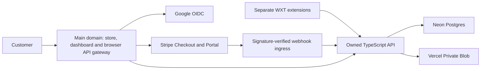

# Paks Tools Faceless automations master plan

> **Status: ACTIVE — living document**  
> **Plan version:** 2.1  
> **Owner:** PAKS LLC / Paks Tools Faceless automations  
> **Last updated:** 2026-08-20  
> **Companion audit:** [`AUDIT_PLAN.md`](AUDIT_PLAN.md)

## Active implementation checkpoint — 2026-08-20

This checkpoint supersedes older current-status tables but does not rewrite
their historical evidence. Source versions targeted by the coordinated change
set are:

| Surface / package       | Source target    | Deployment status                                                  |
| ----------------------- | ---------------- | ------------------------------------------------------------------ |
| Monorepo infrastructure | `0.3.5`          | Local source only; authorized release remains blocked by gates     |
| Dashboard               | `0.2.6`          | Local source only; current stable deployment predates this source  |
| Platform API            | `0.2.6`          | Local source only; current stable deployment predates this source  |
| Platform contracts      | `0.1.2`          | Local source only                                                  |
| Grok Automator™         | `0.0.13`         | Local source only; no CWS upload/submission/publication authorized |
| Database migration set  | `0005_guide_cms` | Source present; applied production version is unverified           |

The interim production topology remains exactly
`https://paks-tools.vercel.app` for the dashboard/browser gateway and
`https://paks-api.vercel.app` for the upstream and extension API. The future
`paks.tools` and `api.paks.tools` domains remain inactive external work.

### Security remediation ledger

| Finding / control gap                                        | Source status                     | Remaining proof                                                     |
| ------------------------------------------------------------ | --------------------------------- | ------------------------------------------------------------------- |
| Static extension Origin treated as client proof              | v2 remediated; v1 exception open  | Roll out `0.0.13`, measure adoption, then disable v1 at sunset      |
| Quota decision used a stale concurrent database snapshot     | Remediated in source              | Real PostgreSQL boundary-concurrency proof                          |
| Unbounded auth-flow creation and durable expired rows        | Remediated in source              | Apply through `0005`, deploy retention, and run abuse tests         |
| Compressed/structurally expansive spreadsheet import         | Remediated in source              | Packaged-browser adversarial import proof                           |
| Unbounded media fetch, decode, and canvas dimensions         | Remediated in source              | Packaged-browser media-boundary proof                               |
| Oversized extension images and chunk reassembly              | Remediated in source              | Packaged-browser transfer proof                                     |
| Remote auth/usage JSON buffered before applying limits       | Remediated in source              | Authorized hostile-server browser proof                             |
| Cancelled auth could persist a just-completed session        | Remediated in source              | Packaged-browser cancellation/restart proof                         |
| Retry could regenerate work or miss terminal download fail   | Remediated in source              | Packaged-browser terminal-download proof                            |
| Local queue/server usage finalization could diverge          | Remediated in source              | Packaged-browser crash/reload proof                                 |
| Unbounded LAN development API request buffering              | Remediated in source              | Deployed early-`413` abuse proof                                    |
| Audit history stopped after the first page                   | Remediated in source              | Authenticated deployed admin pagination proof                       |
| Daily cron replayed already-applied locking DDL              | Remediated in source              | Deployed cron and current-schema proof                              |
| Dashboard deployment bundled the root `api/index` Function   | Guarded locally, live gap         | Authorized empty-inventory candidate, qualification, and promotion  |
| Cleanup could remove an unaliased rollback deployment        | Remediated in source              | Authorized failure-cleanup candidate proof                          |
| Guide content could introduce executable markup or bad URLs  | Prevented by structured contracts | Deployed public/admin renderer and XSS/link denial proof            |
| Email-only administrator checks could drift or be reassigned | Prevented by one-time binding     | Apply `0005`, enroll both owners, and inspect subject/audit records |

Extension auth protocol v2 first binds the flow to a server-verified Google web
session, then requires that same session, its CSRF token, and the short code
displayed only by the initiating extension before authorization. The code is
stored only as a server-side privacy-keyed hash, attempts are bounded, and the
PKCE exchange is one-time. `Origin` remains a CORS/routing signal; it is not
accepted as proof that a raw HTTP client is the installed extension.

The intentionally non-breaking compatibility window keeps exact v1 auth and
usage wire responses available through `2026-11-30T00:00:00Z`, with
`Deprecation` and `Sunset` response headers. That preserves already installed
clients but also preserves their Origin-only initiator weakness until v1 is
disabled. Release order is therefore mandatory: deploy the dual-protocol API
and dashboard together, roll out Grok Automator™ `0.0.13`, monitor minimum
client-version and v1 traffic, then disable v1 at the sunset. The finding is not
fully closed before that final step, and rollback compatibility must be proven
before any surface is promoted independently.

Grok Automator™ keeps a schema-validated, size- and time-bounded prompt group,
including prepared images, in extension-origin IndexedDB while server usage is
blocked or finalized but has not started. Finalization alone does not run work:
an idempotent local release makes the group eligible, and the worker atomically
replaces its payload with an IDs-only claimed receipt before the first Grok
action. Pre-start reload can restore the released payload; claimed work is
surfaced as interrupted and never auto-replayed. Terminal completion,
cancellation, expiry, and rollback remove the durable record. The privacy
notice and release gates treat that transient local payload as disclosed data,
not as an IDs-only receipt.

Root release tooling binds the exact PAKS org/project IDs and canonical
`vercel.dashboard.json` or `vercel.api.json`. It copies a surface-specific
allowlist, rejects common credential/key artifacts, generates the selected
config as stage-root `vercel.json`, and creates a production-target candidate
with `--skip-domain` and no `--local-config`. It validates exact Functions,
rewrites, headers, cron metadata, liveness, and fail-closed readiness, and then
promotes only the unchanged qualified deployment. API order is candidate,
migrate, qualify, promote: migration requires exact local evidence, verifies the
canonical cron is bound to the unaliased candidate while a different prior
deployment remains stable, records an intent before server-side invocation,
rechecks the binding before and after, and polls only the candidate deployment.
It never downloads `CRON_SECRET`. Because the CLI cron trigger has no deployment
selector, ambiguous state fails closed; provider-side TOCTOU is narrowed, not
claimed impossible. Release actions sharing one checkout/evidence directory use
an exclusive per-surface lock across different candidate IDs, while evidence
has an additional per-deployment lock and synced temporary-file atomic
replacement; existing or stale locks fail closed pending manual outcome review.
The lock is not distributed across clones, hosts, or CI, so release authority
must remain with one operator/checkout and provider-state drift checks remain
mandatory. An interrupted migration retry never reinvokes the cron: it reproves
identity/binding and records an explicit recovery only after candidate readiness
succeeds. A production-target
API candidate may be scheduled before explicit migration, so its exposure is
recorded during validation and API cleanup is always refused. Candidate removal
is not a shared-database rollback, so migration SQL must remain compatible with
the prior stable API. Dashboard cleanup requires exact local evidence;
arbitrary unaliased deployments remain rollback assets. Promotion writes intent
before invocation, reconciles exact already-promoted state on retry, and is not
recorded until a bounded postcheck proves `targets.production` and the canonical
cron both bind the candidate. The release validator also blocks an API cutover when the
legacy-protocol sunset is stale or less than 30 days away. Every external action
needs `--execute`; no deploy, migration, promotion, cleanup, push, or store action
occurred in this checkpoint.

No authorized candidate has yet proven that Vercel exposes the required
pre-migration combination: cron deployment ID/host on the skip-domain candidate
while `targets.production` remains the distinct prior stable deployment.
Read-only inspection proved the JSON shape only. If provider semantics differ,
the exact parser blocks the release; this invariant must not be relaxed without
new reviewed release design and evidence.

Audit-start Git evidence remains unresolved, not normalized away: HEAD
`c4527a5bb4eff53359af7fcc587f407935a0855d`, 62 tracked changes, and 185
untracked paths. The exact deployed commits are unknown, so `PLAT-06` and final
GO/NO-GO remain open.

## 1. Purpose

Build Paks Tools Faceless automations into one account-based platform that sells and
delivers:

1. a license for one named Chrome extension;
2. an All Apps license covering the extension collection;
3. one-time digital products such as files, templates, prompt packs, and other
   downloadable assets; and
4. a central dashboard where customers sign in, purchase, manage licenses, and
   retrieve their library.

The platform must preserve each extension's narrow Chrome Web Store purpose.
An All Apps purchase grants account entitlements across separate extensions; it
does not combine unrelated tools into one extension.

## 2. North-star outcome

A customer can sign in with Google, purchase through Stripe, receive the exact
license or digital-product entitlement purchased, use authorized extensions,
download owned files, manage billing, and recover access from any supported
browser without receiving a reusable provider token or static license bypass.

No customer-visible success state may be based only on a redirect, HTTP 200,
client-authored flag, or unverified webhook.

## 3. Committed platform decisions

| Area              | Decision                                                                    | Status        |
| ----------------- | --------------------------------------------------------------------------- | ------------- |
| Web and dashboard | TypeScript application in a dedicated Vercel project                        | `IN PROGRESS` |
| API               | TypeScript API in a separate Vercel project                                 | `IN PROGRESS` |
| Database          | Neon Postgres                                                               | `IN PROGRESS` |
| File delivery     | Vercel Private Blob with authenticated, short-lived download access         | `IN PROGRESS` |
| Payments          | Stripe Checkout, Stripe Billing, verified webhooks, and Customer Portal     | `IN PROGRESS` |
| Identity          | Google SSO only                                                             | `IN PROGRESS` |
| Authorization     | Backend-authored, account-bound entitlements                                | `IN PROGRESS` |
| Extensions        | Separate WXT, strict TypeScript, Manifest V3 applications                   | `IN PROGRESS` |
| Extension secrets | No Stripe, Google, database, signing, or provider secrets in extension code | `PASS` policy |
| Product icons     | Locally bundled Tabler icons                                                | `IN PROGRESS` |
| Typography        | Locally bundled Instrument Serif, Manrope, and IBM Plex Mono                | `IN PROGRESS` |
| Administration    | Server-authorized users, access, platform settings, and immutable audit UI  | `IN PROGRESS` |
| Tool guides       | Structured public documents with protected revisioned CMS authoring         | `IN PROGRESS` |

`PASS policy` means the policy is approved; implementation and release audits
still require evidence under the companion audit plan.

## 4. Owner decisions still required

These decisions block production activation, not independent local work:

- purchase and verify the selected `paks.tools` apex, attach the exact web/API
  custom origins, and complete the staged callback, CORS, extension-permission,
  and DNS cutover; interim PAKS Vercel origins and exact local/LAN origins are
  registered;
- activate and prove preview database/provider isolation, approve runtime-region
  placement, and exercise the new guarded candidate/qualification/promotion
  workflow for both Vercel projects;
- Neon backup, restore, retention, deletion, branching, and preview-isolation
  policy for the provisioned production resource;
- Stripe account, business verification, statement descriptor, currencies,
  refund policy, support contact, restricted API key, webhook endpoints, and
  live Price IDs;
- whether each individual extension license is one-time, annual, or both;
- whether the All Apps license is monthly, annual, or both;
- exact meaning of any one-time bundle and whether future products are excluded;
- tax registrations and product tax codes confirmed with the owner's tax
  adviser before Stripe Tax is relied upon;
- final Chrome Web Store extension IDs for production and test environments;
- account/device/session policy and acceptable concurrent-use limits;
- maximum asset size, download allowance, version-retention policy, and customer
  deletion behavior;
- production administrator identities, roles, recovery, and incident ownership;
- expected launch traffic, rate limits, quota policy, support SLA, and recovery
  objectives.

## 5. Product and license model

### 5.1 Product classes

| Product class                | Default billing model          | Grant                                                |
| ---------------------------- | ------------------------------ | ---------------------------------------------------- |
| Individual extension license | One-time or recurring Price    | `extension:<appId>`                                  |
| All Apps Pass                | Monthly or annual subscription | `bundle:all-extensions` while the subscription lives |
| Versioned app pack           | One-time Price                 | Explicit, immutable list of extension grants         |
| Digital download             | One-time Price                 | `asset:<assetId>` or `collection:<collectionId>`     |

Billing cadence and authorization scope are separate concepts. The database
must not infer access from product names, displayed prices, or frontend state.

### 5.2 Truthful bundle rules

- A recurring All Apps Pass may include current and future extensions only
  while the subscription remains eligible.
- A one-time bundle must have a versioned name and an explicit product list.
- Do not advertise lifetime access to unspecified future products.
- Refunds, disputes, subscription cancellation, expiration, and administrative
  revocation must resolve predictably from written terms.
- One Google account is the customer identity. Static license keys are not the
  normal authorization mechanism.

### 5.3 Extension Run decision

All tools remain visible. Authorization is evaluated when the customer clicks
**Run**.

```text
Run requested
  -> no valid app session
       -> show Google-only sign-in dialog
       -> complete owned PKCE-bound browser flow
       -> resume the pending Run once
  -> valid session, no applicable entitlement
       -> show exact product/All Apps purchase choices on the owned domain
       -> do not run
  -> entitlement expired, revoked, unpaid, or disputed
       -> show billing or renewal action
       -> do not run
  -> active app or All Apps entitlement
       -> obtain server-side usage authorization
       -> run the existing local automation workflow
```

Authentication proves identity. It does not prove payment or entitlement.

## 6. Target deployment topology



Interim Vercel production origins:

```text
https://paks-tools.vercel.app website, auth UI, dashboard, browser /v1 gateway
https://paks-api.vercel.app   upstream API, extension API, provider backend
```

Selected future custom-domain pattern:

```text
https://paks.tools       website, store, auth UI, dashboard, Google callback
https://api.paks.tools   upstream API, extension API, Stripe webhooks
```

The dashboard and API are separate Ready Vercel production deployments connected
to the same monorepo. Their stable and immutable URLs, deployment IDs, endpoint
results, browser checks, and incomplete gates are recorded in
[`VERCEL_DEPLOYMENT.md`](VERCEL_DEPLOYMENT.md). Production, preview, and local
environments must use different databases, Stripe modes, OAuth clients or
callbacks, secrets, and exact CORS allowlists.

Browser sessions call same-origin `/v1/*` and `/health/*` paths on the web
origin; Vercel rewrites them to the upstream API project. This preserves secure
cookie semantics without weakening `SameSite` or adding a cross-site browser
session. Extensions call the upstream API origin directly with short-lived,
app-scoped bearer sessions and never receive the dashboard cookie.

## 7. Application information architecture

```text
/
├── extensions
│   └── :appSlug
├── digital-products
│   └── :productSlug
├── pricing
├── terms
├── refund-policy
├── privacy
├── guide
│   └── :toolSlug
├── auth
├── admin
│   └── guides
└── dashboard
    ├── overview
    ├── licenses
    ├── library
    ├── downloads
    ├── billing
    ├── sessions
    └── account
```

The public catalog explains what is free, what requires payment, what each
license includes, billing cadence, renewal behavior, refund terms, download
formats, file size, and support expectations before Checkout begins.

## 8. Service boundaries

### 8.1 Web dashboard

- Public catalog, pricing, terms, privacy, and support information.
- Google-only account entry.
- Server-created Stripe Checkout sessions.
- Owned licenses and digital-product library.
- Customer Portal link for supported billing management.
- Authenticated download requests; never expose the Blob credential.
- Server-authorized administration for platform metadata/theme, user
  ban/restore, entitlement revocation, structured tool guides, and immutable
  audit events.
- Public tool manuals render only schema-validated structured content; raw HTML
  and executable content are not CMS capabilities.

### 8.2 Platform API

- Google OIDC and extension PKCE exchange.
- Stripe Checkout creation from server-owned SKU mappings.
- Stripe webhook verification, idempotency, order projection, and revocation.
- Provider-neutral entitlement resolution.
- Extension session and usage authorization.
- Private asset authorization and short-lived delivery.
- Rate limiting, audit records, redacted operational logs, and health checks.
- Administrator allowlisting, CSRF-bound mutations, session revocation, and
  immutable attribution for access-changing actions.
- One-time administrator enrollment from a server-only verified-email bootstrap
  list, followed by persisted immutable Google issuer/subject authorization.
- Published tool-guide reads plus revision-checked create/update operations and
  immutable document snapshots.

### 8.3 Extensions

- Display tools without embedding payment UI.
- Open only the owned authentication or purchase surface after a user gesture.
- Keep a short-lived Paks Tools Faceless automations application session in
  extension session storage.
- Request app-specific authorization from the exact owned API origin.
- Never receive Google tokens, Stripe secrets, database credentials, or provider
  webhooks.

## 9. Data model

The first production schema should cover these logical areas. Final table names
may change, but responsibilities must not collapse across trust boundaries.

| Area          | Minimum records                                                      |
| ------------- | -------------------------------------------------------------------- |
| Identity      | users, Google identities, admin identities, web/extension sessions   |
| Catalog       | products, prices, app registry, bundle membership, asset versions    |
| Commerce      | Stripe customers, orders, order items, subscriptions, webhook events |
| Authorization | entitlements, entitlement sources, revocations, usage decisions      |
| Fulfillment   | digital assets, download grants, download events                     |
| Operations    | audit events, idempotency keys, rate-limit state, migration history  |
| Documentation | tool guides, publication state, immutable guide revisions            |

Required constraints include unique Google issuer/subject, unique processed
Stripe event ID, unique provider/customer mapping, idempotent order projection,
explicit entitlement validity, and foreign keys that prevent cross-account
access.

## 10. Provisional API surface

### Identity and sessions

- `GET /v1/auth/google/start?client=dashboard`
- `GET /v1/auth/google/callback`
- `POST /v1/auth/extension-flows`
- `GET /v1/auth/extension-flows/:flowId`
- `POST /v1/auth/extension-flows/:flowId/verify`
- `POST /v1/auth/extension-flows/:flowId/exchange`
- `GET /v1/session`
- `POST /v1/auth/logout`

### Catalog and commerce

- `GET /v1/catalog`
- `GET /v1/catalog/products/:slug`
- `POST /v1/checkout/sessions`
- `POST /v1/webhooks/stripe`
- `POST /v1/billing-portal-sessions`
- `GET /v1/orders`

### Entitlements and extension use

- `GET /v1/entitlements`
- `GET /v1/apps/:appId/entitlement`
- `POST /v1/apps/:appId/usage/reservations`
- `POST /v1/apps/:appId/usage/reservations/:id/consume`
- `POST /v1/apps/:appId/usage/reservations/:id/finalize`
- `POST /v1/apps/:appId/usage/reservations/:id/rollback`
- `POST /v1/apps/:appId/usage/reservations/:id/cancel`
- `POST /v1/apps/:appId/usage/authorize` (temporary v1 compatibility only,
  through `2026-11-30T00:00:00Z`)
- `GET /v1/apps/:appId/config`

### Platform administration

- `GET /v1/admin/session`
- `GET /v1/admin/overview`
- `GET|PUT /v1/admin/platform-settings`
- `GET /v1/admin/users`
- `POST /v1/admin/users/:userId/ban`
- `POST /v1/admin/users/:userId/unban`
- `GET /v1/admin/entitlements`
- `POST /v1/admin/entitlements/:entitlementId/revoke`
- `GET /v1/admin/audit-events`
- `GET /v1/admin/guides`
- `POST /v1/admin/guides`
- `GET /v1/admin/guides/:slug`
- `PUT /v1/admin/guides/:slug`

### Public tool guides

- `GET /v1/guides/:slug` (published documents only)

### Digital delivery

- `GET /v1/library`
- `POST /v1/assets/:assetId/downloads`
- `GET /v1/downloads/:grantId`

Every request, persistence read, provider response, and outgoing payload is
runtime-validated. Route names remain provisional until implementation locks a
versioned contract.

## 11. Stripe integration rules

- Use Stripe-hosted Checkout Sessions for both one-time and subscription sales.
- The client submits an internal product or offer slug. The server resolves the
  allowed Stripe Product and Price; arbitrary client-authored Price IDs are
  rejected.
- Checkout success redirects are informational only. Fulfillment is driven by
  signature-verified, idempotently processed webhooks.
- Maintain internal entitlements because one-time licenses, bundles, downloads,
  and subscriptions share one authorization model.
- Use Customer Portal for supported invoice, payment-method, subscription, and
  cancellation management.
- Use restricted Stripe keys with the minimum required permissions where
  supported. Store every secret only in the deployment secret manager.
- Omit `payment_method_types` so Checkout can use configured dynamic payment
  methods.
- Separate test and live mode completely.
- Do not rely on Stripe Tax until the owner has confirmed active registrations
  and correct product tax codes.

Initial webhook coverage must include successful Checkout, paid and failed
subscription invoices, subscription updates/deletions, refunds, disputes, and
any Stripe Entitlements event deliberately adopted later.

### 11.1 Implementation checkpoint — 2026-08-16

This checkpoint records implemented source and provisioned resources. It does
not promote any production gate to `PASS` without the separate evidence required
by `AUDIT_PLAN.md`.

| Scope                     | Status        | Current checkpoint                                                                        |
| ------------------------- | ------------- | ----------------------------------------------------------------------------------------- |
| Dashboard                 | `IN PROGRESS` | `0.2.3` targets the interim PAKS web/gateway origin; deployment verification is pending   |
| Platform API              | `IN PROGRESS` | `0.2.3` Ready deployment fixes first-login persistence; wider platform gates remain open  |
| Neon                      | `IN PROGRESS` | Production schema is current through `0002`; backup/restore proof remains pending         |
| Private Blob              | `IN PROGRESS` | Private production store and server adapter exist; customer delivery is not built         |
| Google identity           | `PASS`        | Fresh dashboard callback and registered-extension PKCE exchange passed live               |
| Stripe commerce           | `IN PROGRESS` | Checkout and verified idempotent webhook intake exist; fulfillment is still pending       |
| Extension authorization   | `IN PROGRESS` | `0.0.10` local CI/ZIP pass; signed-in browser and live licensed proof remain pending      |
| Vercel production deploys | `IN PROGRESS` | PAKS project rename, env snapshot, deploy evidence, and Git parity remain pending         |
| Chrome Web Store          | `BLOCKED`     | `0.0.10` ZIP is locally verified; final ID and authorized submission evidence are missing |

Current public environment registry:

| Role                           | Exact origin/value                                    |
| ------------------------------ | ----------------------------------------------------- |
| Dashboard/browser API gateway  | `https://paks-tools.vercel.app`                       |
| Upstream/extension API         | `https://paks-api.vercel.app`                         |
| Future dashboard/custom domain | `https://paks.tools` (inactive until purchased)       |
| Future upstream custom domain  | `https://api.paks.tools` (inactive until attached)    |
| Local dashboard                | `http://localhost:5173`                               |
| Local dashboard loopback       | `http://127.0.0.1:5173`                               |
| Current approved LAN dashboard | `http://10.56.55.108:5173`                            |
| Current unpacked extension     | `chrome-extension://gegefkobmeapidelleohofpcigokggci` |

The unpacked extension ID is path/profile-derived because the manifest has no
public key. It is a development registration only and must be re-audited if the
path, browser profile, manifest key, or final Chrome Web Store item changes.
Every credential and secret remains Vercel-only; this project never uses
`vercel env pull` to make a local copy.

Live scaffold status is intentionally narrower than production readiness:
`/health/live` and `/v1/platform-settings` return `200`, anonymous admin returns
`401`, and `/health/ready` returns `503 not_ready` until the required Google,
Stripe, and administrator configuration exists.

### 11.2 Google first-login incident checkpoint — 2026-08-17

API `0.2.3` replaces the writable-CTE first-account session path with ordered
statements inside a Neon transaction. This removes the PostgreSQL snapshot
visibility failure in which a sibling update could not see the newly inserted
user and therefore produced no session row. Successful dashboard OAuth now
returns to `/`, which is an implemented route, rather than `/dashboard`.

The callback also emits stage-coded, non-secret diagnostics so an operator can
separate provider, claim, persistence, and flow-completion faults without
capturing codes, tokens, cookies, PKCE values, or provider subjects. API CI
passes 7 files and 26 tests, including contiguous-placeholder coverage.

The clean release is Ready as `dpl_5scMFAw976ScifQCAdZFLFCGRCKF`, with immutable
host `paks-bvz2tyxqn-atmt.vercel.app` and stable alias
`paks-api.vercel.app`. A fresh registered-extension browser journey reached
**Account connected**; its one-time PKCE exchange returned `200 authorized`, and
replay returned `409 auth_flow_consumed`. Dashboard OAuth returned to `/`. This
passes the live Google extension-SSO checkpoint without claiming paid access or
an authorized Grok Run. The original denied user flow remains terminal and must
be replaced by a new request started from the extension.

## 12. Milestones and exit gates

Gate details and evidence requirements live in `AUDIT_PLAN.md`.

### M0 — decisions and governance

**Goal:** Turn unresolved owner choices into an approved implementation brief.

- Confirm domain, environments, regions, pricing cadence, bundle semantics,
  refund terms, tax readiness, session policy, file limits, and administrators.
- Assign stable app IDs and product/asset naming rules.
- Approve privacy, terms, refund, support, and incident owners.

**Exit gates:** `PLAN-01` through `PLAN-05`.

### M1 — active TypeScript platform workspace

**Goal:** Activate `apps/faceless-platform-api` with deployable Vercel adapters
without weakening the provider-neutral core.

- Add strict TypeScript workspace, validation, tests, security scans, build, and
  root CI coverage.
- Add environment schema that fails closed.
- Add health endpoints, request bounds, error redaction, and structured logs.

**Exit gates:** `PLAT-01` through `PLAT-08`, `SEC-01`, `OPS-01`.

### M2 — Neon persistence foundation

**Goal:** Provide isolated, migratable, recoverable state.

- Implement schema, migrations, indexes, constraints, and test fixtures.
- Establish separate local/test/preview/production databases.
- Prove backup, restore, retention, and deletion procedures.

**Exit gates:** `DATA-01` through `DATA-07`.

### M3 — Google-only identity

**Goal:** Complete dashboard and extension authentication without exposing
Google credentials to extensions.

- Configure consent screen, owned domains, exact callbacks, state, nonce, and
  PKCE.
- Implement web cookies and separate short-lived extension sessions.
- Enforce exact CORS and registered extension identity.
- Enroll configured verified Google emails once and bind every administrator
  session to the persisted issuer/subject; never ship the bootstrap list.

**Exit gates:** `AUTH-01` through `AUTH-13`, `PRIV-01`.

### M4 — Stripe catalog and commerce

**Goal:** Accept test-mode payments and project them exactly once.

- Configure Products and Prices for individual licenses, All Apps, and digital
  products.
- Implement Checkout, verified webhooks, order projection, refunds, disputes,
  subscription changes, and Customer Portal.
- Establish test/live secret separation and reconciliation tools.

**Exit gates:** `PAY-01` through `PAY-12`, `SEC-02`, `PRIV-02`.

### M5 — entitlement engine

**Goal:** Make access decisions independent of UI and billing-provider state.

- Resolve direct app, All Apps, versioned bundle, and digital-asset grants.
- Handle activation, renewal, expiry, refund, dispute, cancellation, revocation,
  and administrative correction.
- Enforce idempotency and concurrent authorization correctness.

**Exit gates:** `LIC-01` through `LIC-12`.

### M6 — digital-product fulfillment

**Goal:** Deliver only purchased asset versions through authenticated access.

- Store private asset versions and integrity metadata.
- Authorize short-lived downloads and record delivery events.
- Prevent path substitution, cross-account reads, unsafe content types, and
  uncontrolled caching.

**Exit gates:** `FILE-01` through `FILE-07`, `FILE-09`, and `FILE-10`.

### M7 — customer dashboard and storefront

**Goal:** Complete public catalog, account dashboard, library, billing, dynamic
tool manuals, and recovery UX across desktop and mobile.

- Implement truthful offer comparison and purchase recovery.
- Show entitlement state, expiration, asset version, and billing actions.
- Cover empty, loading, error, revoked, unpaid, and inaccessible states.
- Publish responsive `/guide/:slug` documents from safe structured blocks and
  provide a reusable administrator list/create/editor with optimistic conflict
  handling, drafts, accessible controls, and immutable history.

**Exit gates:** `UX-01` through `UX-10`, `A11Y-01` through `A11Y-04`, and
`CMS-01` through `CMS-08`.

### M8 — Grok Automator™ paid-access integration

**Goal:** Enforce authentication and entitlement at Run without hiding tools or
breaking recovered automation behavior.

- Preserve visible tools and existing local queue/download workflow.
- Resume a pending Run only once after successful authentication.
- Reject signed-in but unlicensed users with an exact purchase path.
- Show the verified connected account and exact session-resolved Free,
  individual-extension, or All Apps plan without exposing tokens or adding a
  profile request.
- Keep one central footer across primary views with a package-version-matched
  local Shields badge and exact copyright, without a runtime badge request.
- Add no speculative permissions or payment/provider code to the extension.

**Exit gates:** `WXT-01` through `WXT-15`, `LIC-09`, `SEC-03`.

### M9 — production readiness and controlled launch

**Goal:** Prove full test-mode and authorized low-volume production journeys.

- Complete privacy, terms, refund, support, tax, monitoring, recovery, and CWS
  materials.
- Run full monorepo CI, deployment audits, payment reconciliation, download
  fulfillment, extension smoke, ZIP integrity, and CWS checks.
- Keep public, submitted, deployed, database, and payment-provider states
  separate in the release record.

**Exit gates:** every required gate in `AUDIT_PLAN.md`, followed by owner
`GO / NO-GO` sign-off.

## 13. Definition of done

The platform is production-ready only when all of the following are true:

- Google SSO works on owned production origins and no alternative sign-in path
  exists.
- Stripe live Checkout and verified webhooks create exactly one order and the
  correct entitlement; refunds and subscription loss revoke access as defined.
- Direct-extension and All Apps authorization work from at least two clean
  browser profiles without exposing reusable provider credentials.
- A signed-in customer without an entitlement cannot Run a paid extension.
- Purchased files are inaccessible to other accounts and downloadable through
  short-lived authenticated delivery.
- Database restore, secret rotation, webhook replay, reconciliation, and account
  deletion procedures have been exercised.
- Dashboard desktop/mobile, accessibility, failure-state, and recovery audits
  pass.
- Every extension passes WXT, MV3, permission, privacy, banner, source-map,
  remote-code, ZIP, version-integrity, and manual browser checks.
- Terms, privacy, refund, seller identity, paid-function disclosure, support,
  and tax configuration match actual behavior.
- Production monitoring and incident ownership are active.
- The owner signs a recorded production `GO` decision for the exact commit,
  deployment, Stripe mode, database, asset store, and extension artifact.

## 14. Key risks

| Risk                                     | Control                                                         |
| ---------------------------------------- | --------------------------------------------------------------- |
| Login mistaken for paid authorization    | Server resolves entitlements separately on every protected path |
| Redirect mistaken for successful payment | Webhook-driven, reconciled fulfillment only                     |
| Duplicate or out-of-order Stripe events  | Unique event IDs, idempotent projections, monotonic state rules |
| Client changes Product or Price          | Server-owned offer registry                                     |
| All Apps promise becomes ambiguous       | Recurring dynamic scope or immutable versioned bundle           |
| Static license copied between customers  | Account-bound sessions and server authorization                 |
| Cross-account digital download           | Entitlement check plus short-lived private delivery             |
| Extension bundle leaks secrets           | No provider secrets; source/output/ZIP scanners                 |
| CORS accepts an unregistered extension   | Exact environment/app/extension tuple                           |
| Tax appears enabled but collects nothing | Registration and product-tax-code audit before launch           |
| Preview environment affects production   | Separate origins, secrets, databases, Stripe modes, and OAuth   |
| Browser automation claims false success  | Assert upstream result and preserve evidence                    |

## 15. Plan maintenance

For every material change:

1. update the relevant decision, milestone, route, data model, or risk;
2. update affected gate IDs in `AUDIT_PLAN.md`;
3. add a dated entry below;
4. reference the changed plan and gate IDs in the implementation summary; and
5. never mark a milestone complete while a required gate is blocked or failed.

## 16. Change log

### 2026-08-20 — Plan 2.1

- Added the generic structured tool-guide domain, public `/guide/:slug` route,
  reusable protected CMS, published/draft lifecycle, optimistic revisions,
  immutable document snapshots, and dedicated `CMS-01..08` audit gates.
- Advanced coordinated local targets to root `0.3.5`, dashboard `0.2.6`, API
  `0.2.6`, contracts `0.1.2`, Grok Automator™ `0.0.13`, and migration
  `0005_guide_cms` without claiming deployment or migration parity.
- Recorded one-time verified-Google administrator enrollment from the sensitive
  API-only Vercel bootstrap list. The requested Production secret is configured,
  but administrator activation still requires the target deployment, migration,
  and each owner's successful Google claim.

### 2026-08-20 — Plan 2.0

- Recorded the coordinated root `0.3.4`, dashboard `0.2.5`, API `0.2.5`,
  contracts `0.1.1`, Grok Automator™ `0.0.12`, and migration
  `0004_security_lifecycle` source targets without claiming deployment.
- Remediated the validated v2 public-client, API lifecycle, extension-boundary,
  and request-buffering findings in source while retaining and explicitly
  tracking the bounded v1 compatibility exception through its sunset.
- Added guarded, exact-project Vercel candidate/migration/qualification/promotion
  with checkout-local per-surface serialization, durable candidate evidence,
  no-reinvoke recovery, API cron-exposure retention, and exact post-promotion
  production/cron binding proof. Recorded the currently live
  dashboard's unintended `api/index` Function as a deployment gap rather than
  silently treating the alias as release proof.
- Preserved the audit-start dirty-worktree baseline and left Git/deployment
  parity, provider activation, payment fulfillment, private delivery, live Grok,
  and CWS state explicitly unresolved.

### 2026-08-17 — Plan 1.9

- Opened Grok Automator™ `0.0.10` for connected-account and exact
  session-resolved plan presentation using the already validated short-lived
  extension session.
- Added the M8 requirement and `WXT-14` audit gate without adding an API route,
  provider token, remote avatar, host permission, or browser-side secret.
- Kept CI, deterministic signed-in browser evidence, ZIP integrity, paid
  entitlement lifecycle, live Grok execution, and Chrome Web Store outcomes
  explicitly pending.

### 2026-08-17 — Plan 1.8

- Recorded API `0.2.3` as the local fix for first-account Google session
  persistence by replacing the writable-CTE path with an ordered Neon
  transaction.
- Corrected the successful dashboard return route from the nonexistent
  `/dashboard` path to `/` and required stage-coded, non-secret callback
  diagnostics.
- Accepted 7 API test files and 26 tests, including the contiguous-placeholder
  regression, plus Ready deployment `dpl_5scMFAw976ScifQCAdZFLFCGRCKF`.
- Passed live dashboard return-to-root and fresh registered-extension SSO: the
  first PKCE exchange returned `200 authorized` and replay returned
  `409 auth_flow_consumed`; the original denied flow still requires a new
  extension request.

### 2026-08-17 — Plan 1.7

- Selected `paks.tools` and `api.paks.tools` as the future owned web and API
  domains while keeping them inactive until purchase, DNS, and Vercel
  verification are complete.
- Defined `paks-tools.vercel.app` and `paks-api.vercel.app` as the interim
  cutover origins and bound Google OAuth to the web gateway callback so
  `__Host-` cookies remain same-origin.
- Advanced the coordinated root, dashboard, API, and Grok Automator versions
  for the domain migration without moving any secret into source or a local
  environment file.

### 2026-08-17 — Plan 1.6

- Established PAKS LLC as the active legal owner for the Grok Automator™
  footer and emitted JavaScript banner while preserving the `0.0.7` owner text
  only inside its immutable historical changelog and audit record.
- Opened the `0.0.8` release audit and added a production regression against
  reintroducing the prior publisher signature.
- Rechecked the private GitHub repository and Google OAuth production boundary;
  the exact live evidence is recorded in `AUDIT_PLAN.md`.

### 2026-08-16 — Plan 1.5

- Added the `0.0.7` central-footer release scope with an exact copyright
  stamp and locally generated, version-locked Shields badge.
- Required a self/data-only image CSP, no runtime Shields dependency, and
  source/build/ZIP/browser evidence through the new `WXT-13` gate.
- Recorded passing `0.0.7` monorepo CI, deterministic ZIP SHA-256, exact local
  badge/CSP verification, and seven-state isolated Chromium evidence.

### 2026-08-16 — Plan 1.4

- Adopted the exact **Grok Automator™** display identity and owner-provided
  16/32/48/128 PNG artwork while preserving stable machine IDs and routes.
- Recorded the passing `0.0.6` monorepo CI, deterministic ZIP, exact manifest
  identity/icon verification, and seven-state isolated Chromium smoke.
- Kept Google provider configuration, licensed/unlicensed production journeys,
  final Chrome Web Store ID, Git/deployment parity, and store submission open.

### 2026-08-16 — Plan 1.3

- Recorded the passing root monorepo CI, deterministic Grok Automator `0.0.5`
  release ZIP, SHA-256, and seven-state isolated Chromium smoke.
- Advanced the local extension package gates while keeping live licensed and
  unlicensed authorization, low-volume Grok parity, final identity, Git parity,
  and Chrome Web Store submission open.

### 2026-08-16 — Plan 1.2

- Recorded both Ready Vercel production deployments, stable and immutable URLs,
  deployment IDs, live endpoint results, and desktop/mobile browser QA in
  `VERCEL_DEPLOYMENT.md`.
- Recorded the production Neon schema as current through migration `0002` while
  keeping backup/restore, isolation, retention, and deletion gates open.
- Advanced deployment from `NOT RUN` to `IN PROGRESS`: the live scaffold is
  proven, but audited Git parity and provider readiness are not.
- Preserved Google OAuth, Stripe entitlement fulfillment, authenticated admin,
  private delivery, extension paid-access, and Chrome Web Store work as pending
  or blocked.

### 2026-08-16 — Plan 1.1

- Recorded the two temporary Vercel origins, exact local/LAN origin registry,
  disposable unpacked extension ID, and Vercel-only secret policy.
- Advanced dashboard, API, Neon, Private Blob, Stripe, administration, and
  extension authorization from planning into implementation without marking
  deployment, provider journeys, fulfillment, restore, or CWS gates complete.
- Added the implemented administration surface and corrected the extension-flow
  API route map.
- Bound dashboard authentication/admin traffic to a same-origin `/v1` gateway
  while retaining the separate upstream API origin for Vercel and extensions.
- Kept Google OAuth, Stripe catalog/fulfillment, production deployment, private
  digital delivery, full entitlement lifecycle, and owner launch approval as
  explicit blockers or pending work.

### 2026-08-16 — Plan 1.0

- Established the living platform plan around Vercel, Neon Postgres, Vercel
  Private Blob, Stripe, Google-only SSO, separate WXT extensions, account-bound
  individual licenses, All Apps access, and digital-product fulfillment.
- Added milestone exit gates and an evidence-based definition of done.
